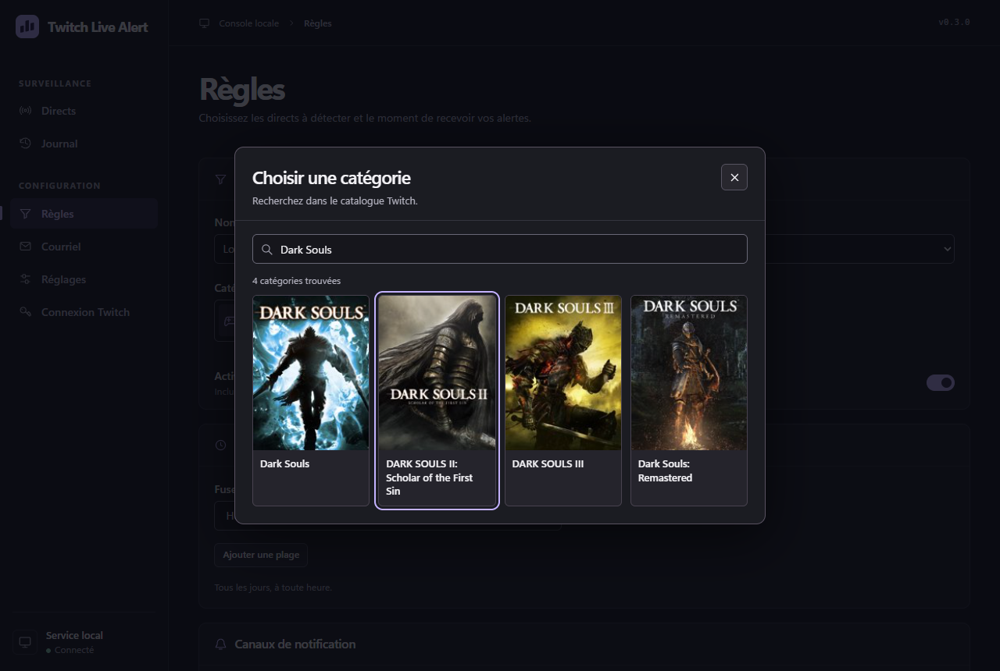

# Twitch Live Alert

[Français](README.md) · [Download for Windows x64](https://github.com/LINDECKER-Charles/twitch-live-alert/releases/download/v0.3.0/Twitch-Live-Alert_0.3.0_x64-setup.exe) · [Release notes](https://github.com/LINDECKER-Charles/twitch-live-alert/releases/tag/v0.3.0)

Follow Twitch streams by category and broadcast language. Create separate rules, receive Windows notifications or email, and search the alert history on your PC. The dashboard runs in a desktop window or your local browser. The interface is in French. The guide below uses the labels you will see on screen.

[Rules screen](docs/design/regles.png) · [Email settings](docs/design/courriel.png)

## Start monitoring

1. Run the unsigned installer on Windows 10 or 11 x64 and open **Twitch Live Alert** from the Start menu. The installer downloads WebView2 if needed. The release page includes the installer’s SHA-256 checksum.
2. Open **Connexion Twitch**. Register your own application in the Twitch Developer Console, using a verified account with two-factor authentication. Enter an available name and `http://localhost` as the redirect URL. Select **Application Integration** and **Confidential** if offered. In **Manage**, copy **Client ID** and generate **New Secret**. [Register a Twitch application](https://dev.twitch.tv/console/apps/create) · [Developer documentation](https://dev.twitch.tv/docs/authentication/register-app/)
3. Save both values in **Connexion Twitch**. After validation, the page shows the connection status and lets you verify, replace or disconnect it. Credentials are used to obtain an application token for public stream information. [Twitch application access tokens](https://dev.twitch.tv/docs/authentication/getting-tokens-oauth/#client-credentials-grant-flow)
4. Open **Règles**. Edit the Bloodborne rule or choose **Nouvelle règle**. Name it, open **Choisir une catégorie**, search and select a category by its name and Twitch artwork. Pick a broadcast language or all languages, select your delivery channels, then save.
5. Use **Directs** for current streams and viewer counts. **Journal** shows delivered alerts and their rule. To configure SMTP or choose specific sending times, follow the [email and scheduling guide](docs/en/SCHEDULES-AND-EMAIL.md).

When upgrading from 0.2.0, your existing filter becomes a rule with Windows notifications. Your history and saved connection are reused. The migration guide covers upgrades and older Bloodborne FR Live profiles. [Migration guide](docs/en/MIGRATION.md)

## Using rules

Each rule can be edited, paused, reactivated or deleted. Deleting a rule keeps its delivery history. A detection window controls when to look for live streams. An email window or digest time controls when to send what was detected. An individual stream may match several rules.

The default polling interval is 60 seconds. Short broadcasts may start and end between polls. The monitor handles pagination and Twitch rate limits. Your PC must be awake and the program running to detect streams. Windows notification settings and Do Not Disturb control whether a banner appears. [Twitch stream API](https://dev.twitch.tv/docs/api/reference/streams#get-streams)

| Section | Purpose |
| --- | --- |
| Directs | See matching streams, the responsible rule and viewer counts. Open a channel on Twitch. |
| Journal | Browse past alerts, search and identify the rule and delivery channel. |
| Analytics | Compare stream frequency and duration by channel over 7, 30 or 90 days, or your entire history. Select a channel to inspect its individual streams. |
| Règles | Name, add, edit, enable or delete rules. See detection windows, email schedules, time zones and whether a rule is currently in its detection window. |
| Courriel | Set up SMTP, sender and recipients, edit templates, preview, or send a test message. |
| Réglages | Set the global polling interval, first observation behaviour and Windows startup. |
| Connexion Twitch | Check the saved Twitch connection, replace the credentials or disconnect. |

Analytics counts each stream once, even when it triggered several alerts. Its minimum duration runs from the start reported by Twitch to the last poll that saw it live. Older alerts with an unknown duration count toward frequency. Average duration uses only streams with a measurement.

## Local data and command line

Closing the desktop window keeps the program in the notification area. **Ouvrir dans le navigateur** opens the browser dashboard. **Quitter** stops the desktop and the service it launched. Both interfaces use [the same loopback service](http://127.0.0.1:37219/).

The installed application stores its data under `%LOCALAPPDATA%\TwitchLiveAlert\data\`. Windows DPAPI protects credentials saved in the application. Stop the service before backing up its profile. Enter the credentials again when moving to a different PC.

From a source checkout, `cargo build --locked --release` creates `target/release/twitch-live-alert.exe`. Launch without arguments to serve the local dashboard. Use `--help` for all options.

| Option | Effect |
| --- | --- |
| `--check-config` | Check configuration without contacting Twitch. |
| `--dry-run` | Read streams from Twitch without notifying or recording a delivery. |
| `--once` | Poll eligible rules once, handle due deliveries and exit. |
| `--no-web` | Run the command-line monitor without the web server. |
| `--port 37220` | Use another loopback port. Give concurrent instances independent data directories. |
| `--test-notification` | Ask Windows to show a test notification. |

The standalone CLI accepts `TWITCH_CLIENT_ID`, `TWITCH_CLIENT_SECRET`, `DATABASE_PATH`, `POLL_INTERVAL_SECONDS`, `NOTIFY_EXISTING_ON_FIRST_RUN` and `RUST_LOG` from its environment or local `.env`. The default database is `data/alerts.sqlite3`. [Example configuration](.env.example)

[Build and distribute on Windows](docs/en/DISTRIBUTION.md) · [Contributor guide](docs/en/CONTRIBUTING.md) · [Dashboard layout and browser checks](docs/en/INTERFACE.md) · [0.2.0 release notes](docs/releases/0.2.0.md) · [MIT license](LICENSE)
