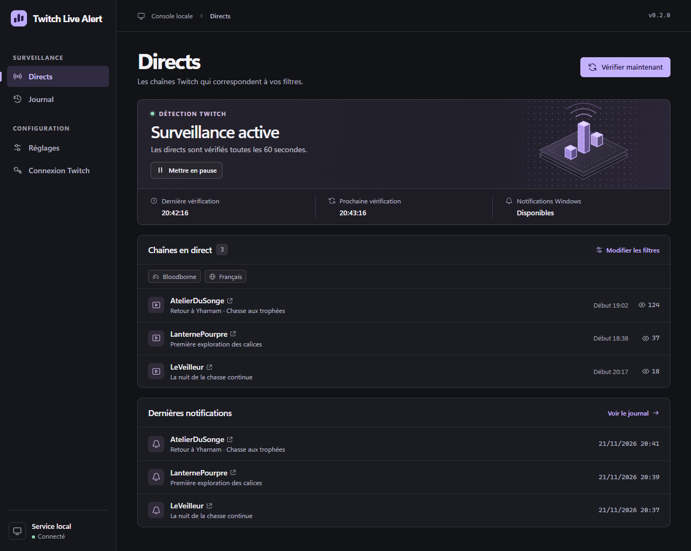

# Twitch Live Alert

Twitch Live Alert vous prévient sous Windows quand une chaîne passe en direct dans la catégorie et la langue que vous suivez. L’application affiche les directs en cours, ouvre la chaîne sur Twitch et conserve un journal consultable après redémarrage.

*Aperçu avec des données de démonstration.*

## Installer et commencer

1. Munissez-vous du fichier `Twitch Live Alert_0.2.0_x64-setup.exe`. Pour le produire depuis le code source, lancez `.\scripts\build-desktop.ps1` sous Windows. [Prérequis et construction](docs/DISTRIBUTION.md)
2. Lancez le fichier `-setup.exe`, puis ouvrez **Twitch Live Alert** depuis le menu Démarrer. Windows 10 ou 11 et Microsoft Edge WebView2 sont nécessaires à la fenêtre de bureau.
3. Ouvrez **Connexion Twitch** et enregistrez les identifiants de votre propre application Twitch. La procédure de création figure ci-dessous.
4. Dans **Réglages**, tapez quelques lettres du nom de la catégorie. Cliquez sur un résultat, ou utilisez les flèches et **Entrée**. Choisissez la langue, puis **Enregistrer les réglages**. Le premier filtre proposé est **Bloodborne · Français**. **Toutes les langues** permet de suivre toute la catégorie. [Aperçu de la recherche](docs/design/recherche-categories.png)
5. Ouvrez **Directs** pour vérifier le dernier relevé. La commande de test des notifications permet aussi de vérifier que Windows accepte les alertes.

Le tableau de bord fonctionne également dans un navigateur, sur le même PC. Dans la zone de notification Windows, le menu de Twitch Live Alert propose **Ouvrir dans le navigateur**. Fermer la fenêtre laisse la surveillance active. **Quitter** arrête le bureau et le service qu’il a lancé. [Ouvrir le tableau de bord local](http://127.0.0.1:37219/)

## Obtenir les identifiants Twitch

1. Connectez-vous à la console développeur avec un compte dont l’adresse e-mail est vérifiée et l’authentification à deux facteurs activée. [Enregistrer une application](https://dev.twitch.tv/console/apps/create)
2. Donnez à l’application un nom disponible. Indiquez `http://localhost` dans **OAuth Redirect URLs**, choisissez **Application Integration** et le type **Confidential** si le formulaire vous le propose.
3. Après la création, ouvrez **Manage**. Copiez le **Client ID**, puis générez un **Client Secret** avec **New Secret**.
4. Saisissez ces deux valeurs dans **Connexion Twitch**. Le service local les vérifie auprès de Twitch avant de les enregistrer. La surveillance utilise un jeton d’application pour lire les directs publics. [Inscription chez Twitch](https://dev.twitch.tv/docs/authentication/register-app/) · [Authentification par identifiants d’application](https://dev.twitch.tv/docs/authentication/getting-tokens-oauth/#client-credentials-grant-flow)

Si vous renouvelez le secret dans la console Twitch, remplacez-le également dans l’application. Twitch invalide le précédent lors de cette opération.

## Suivre des directs

| Vue | Ce que vous pouvez y faire |
| --- | --- |
| Directs | Voir les chaînes du dernier relevé, leur titre et leur audience, ouvrir une chaîne, vérifier maintenant ou suspendre la surveillance. |
| Journal | Rechercher une alerte par chaîne ou titre, parcourir les résultats et retrouver la chaîne. |
| Réglages | Choisir la catégorie, la langue déclarée par le diffuseur, l’intervalle et le comportement au premier relevé. |
| Connexion Twitch | Configurer ou remplacer les identifiants utilisés par le service. |

Le service vérifie Twitch toutes les 60 secondes par défaut. Il lit les pages successives de la catégorie. Une diffusion très courte peut passer entre deux relevés et le classement des chaînes peut changer pendant la pagination. La veille du PC et la fermeture de session interrompent la surveillance. En cas de limitation de débit, la prochaine tentative est différée. [Liste des directs](https://dev.twitch.tv/docs/api/reference/streams#get-streams) · [Pagination et limites de débit](https://dev.twitch.tv/docs/api/guide/)

Sur un profil neuf, le premier relevé complet d’un filtre enregistre silencieusement les chaînes déjà en ligne. Les nouvelles diffusions déclenchent ensuite une alerte. Une option dans **Réglages** permet d’alerter dès le premier relevé. Pour une catégorie très suivie, elle peut déclencher de nombreuses notifications.

Les alertes traitées restent dans SQLite. Si Windows refuse une notification, le service peut la réessayer au prochain relevé. Une interruption entre l’acceptation de l’alerte par Windows et l’écriture dans SQLite peut produire un doublon. Le journal retrace les alertes transmises au système. L’affichage des bannières dépend aussi de **Paramètres Windows → Système → Notifications**, du mode **Ne pas déranger** et des préférences de l’utilisateur.

## Données et modes de lancement

Le bureau utilise WebView2 et lance un service Rust local. Ce service écoute sur `127.0.0.1:37219`, sert les fichiers de l’interface et gère seul les appels à Twitch, les notifications et les écritures SQLite. Le navigateur accède à cette même adresse. Une seconde fenêtre consulte le même service.

L’installation Windows conserve les réglages et le journal dans `%LOCALAPPDATA%\TwitchLiveAlert\data`. Les identifiants enregistrés par l’interface sont chiffrés avec **Windows DPAPI** pour le compte courant. Pour transférer la surveillance vers un autre PC, copiez le journal et les réglages après arrêt du service, puis renseignez les identifiants sur le nouveau PC.

Vous utilisiez **Bloodborne FR Live** ? Vous pouvez reprendre le journal, les réglages et la déduplication dans le nouveau profil Windows. [Migrer une installation existante](docs/MIGRATION.md)

Pour construire l’installateur, lancer les contrôles du dépôt ou proposer une modification, consultez les guides. [Distribution Windows](docs/DISTRIBUTION.md) · [Contribuer](CONTRIBUTING.md)

### Ligne de commande

Depuis la racine du dépôt avec Rust installé, utilisez `cargo build --locked --release`. Le service autonome se trouve dans `target/release/twitch-live-alert.exe`. Sans option, il sert le tableau de bord à l’adresse locale. `Ctrl+C` le ferme.

| Option | Effet |
| --- | --- |
| `--check-config` | Vérifie la configuration sans contacter Twitch. |
| `--dry-run` | Lit les directs sur Twitch sans envoyer de notification ni inscrire de livraison. |
| `--once` | Effectue un relevé avec notification et enregistrement, puis quitte. |
| `--no-web` | Surveille dans le terminal sans serveur HTTP. |
| `--port 37220` | Ouvre le tableau de bord autonome sur un autre port local. Pour exécuter deux services, utilisez des dossiers de données distincts. |
| `--test-notification` | Transmet une notification de test à Windows sans identifiants Twitch. |
| `--help` | Affiche les options disponibles. |

### Configuration du service autonome

Les commandes lancées depuis les sources peuvent lire `.env` dans leur dossier de travail. Le fichier [.env.example](.env.example) contient les noms de configuration. Dans l’environnement de développement de ce dépôt, `coffre deployer alerte-bloodborne-frlive` sous Git Bash synchronise le fichier ignoré par Git. L’installation destinée aux utilisateurs configure Twitch directement depuis l’interface.

| Variable | Utilisation |
| --- | --- |
| `TWITCH_CLIENT_ID`, `TWITCH_CLIENT_SECRET` | Paire d’identifiants de l’application Twitch pour la ligne de commande. |
| `DATABASE_PATH` | Emplacement de la base du service autonome. Par défaut, `data/alerts.sqlite3` dans le dossier de travail. |
| `POLL_INTERVAL_SECONDS` | Intervalle initial, entre 15 et 3 600 secondes. |
| `NOTIFY_EXISTING_ON_FIRST_RUN` | Choix initial pour les directs déjà présents, `true` ou `false`. |
| `RUST_LOG` | Niveau des journaux du service en console, par exemple `info`. |

L’intégration continue compile et teste le service sur Windows et Linux. Les notifications natives et le logiciel de bureau distribué ciblent Windows. La licence MIT est celle du dépôt d’origine. [Licence](LICENSE)
