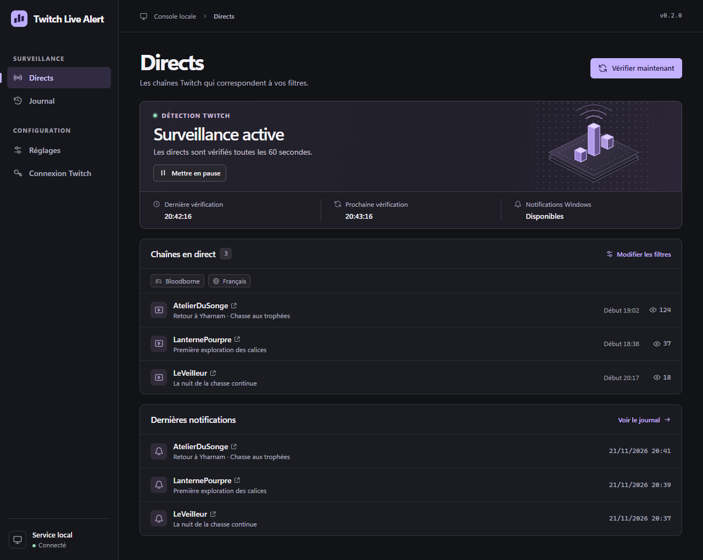

# Planche de la console locale



Capture de présentation réalisée le 22 novembre 2026 à 1 280 px. Les trois chaînes, les audiences et les notifications sont des données de démonstration du [scénario navigateur](verify_ui.py).

| Spécimen | Destination | Implémentation utilisée |
| --- | --- | --- |
| Marque et navigation courante | Toutes | [Pictogramme](../../web/mark.svg), [structure sémantique](../../web/index.html), [navigation par fragment](../../web/app.js) |
| Surveillance, actions et fraîcheur | Directs | [État et commandes](../../web/app.js), [bandeau et réduction mobile](../../web/style.css) |
| Chaîne et notification | Directs et Journal | [Même rendu de rangée, lien de chaîne et date](../../web/lists.js) |
| Recherche, reprise d’erreur et pagination | Journal | [Contrôleur du journal](../../web/lists.js) |
| Filtres, options et identifiants | Réglages et Connexion Twitch | [Formulaires HTML](../../web/index.html), [validation et retours locaux](../../web/app.js) |


Le [sélecteur de catégorie](../../web/category-picker.js) interroge le catalogue 280 ms après la fin de la saisie et présente au plus huit noms. La capture montre des réponses de démonstration pour « Elden ». Au clavier, le focus reste sur le champ pendant le parcours des options. À 390 px, la liste déplace le champ Langue sous les résultats pour le laisser accessible. Le contrat d’interaction suit le modèle de sélection manuelle avec saisie. [W3C, exemple de combobox éditable](https://www.w3.org/WAI/ARIA/apg/patterns/combobox/examples/combobox-autocomplete-list/)

## Rejouer la vérification

Le programme ouvre le navigateur en mode headless, charge les sources de `web/` et intercepte les appels HTTP. Les données et les mutations sont conservées en mémoire pour la durée du scénario. Les réponses HTML portent la politique de contenu du service. Python 3.11 ou ultérieur et Playwright servent uniquement à la vérification.

```sh
python -m pip install playwright
python -m playwright install chromium
python docs/design/verify_ui.py
```

Sur un PC avec Edge déjà installé, `python docs/design/verify_ui.py --channel msedge` utilise ce navigateur. L’option `--captures target/qa/interface` conserve les vues de travail. `--readme docs/design/apercu-directs.png` régénère l’aperçu des directs. L’option `--category-capture docs/design/recherche-categories.png` produit la capture du sélecteur ouvert. Pour l’analyse d’accessibilité, ajouter `--axe chemin/vers/axe.min.js` avec un exemplaire local d’axe-core.

Vérifications des 21 et 22 novembre 2026 avec Edge 158 et axe-core 4.14. Le parcours couvre le premier lancement au clavier, le refus puis l’enregistrement d’identifiants fictifs, l’effacement des champs, les suggestions de catégorie, la langue, la conservation du brouillon, les préférences, le test de notification accepté ou refusé, la demande de vérification, la pause et la reprise. Le journal contient 53 entrées de test pour exercer recherche, pagination, absence de résultat, échec et nouvel essai. Le sélecteur est exercé au clavier, à la souris et au toucher, avec chargement, échec, absence de résultat, réponse périmée et rejet d’une catégorie inconnue. Le test vérifie également la modification de la langue sur un profil sans identifiants et le rendu d’une date de début absente ou invalide. Une catégorie de 120 chaînes vérifie l’affichage initial et le chargement des deux tranches suivantes. Une coupure et une reprise du service vérifient la conservation de la dernière liste.

La vue Directs a aussi été capturée à 1 180 × 820 px. Les quatre destinations ont été testées à 390 et 320 px sans débordement horizontal. Les captures Directs, Journal, Connexion, Réglages mobile, premier lancement et dégradation ont fait l’objet d’une inspection visuelle. Les règles WCAG A et AA sélectionnées par le script n’ont produit aucune violation sur les quatre destinations à 1 280 px. La livraison réelle d’une alerte Windows et l’authentification Twitch nécessitent un autre essai avec le service et son environnement de bureau.
