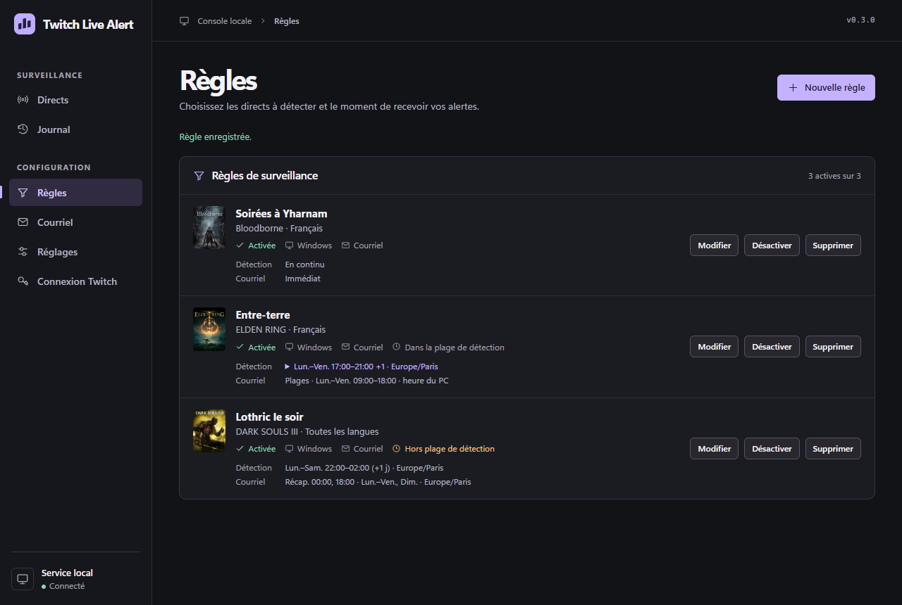
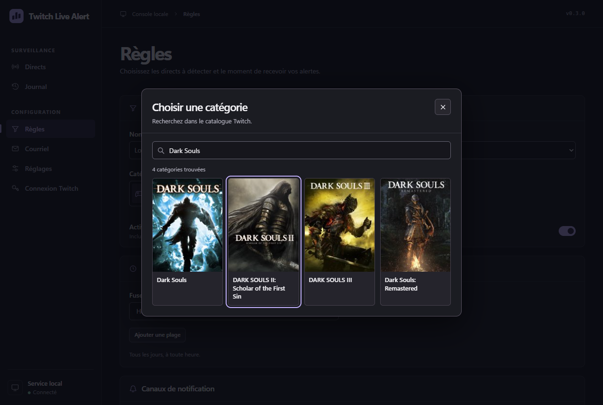

# Planche de la console 0.3.0

[English overview](../en/INTERFACE.md)






[Configuration du courriel et aperçu de modèle](courriel.png) · [Catalogue à 390 px](catalogue-mobile.png)

## Sources des captures

Captures réalisées le 22 novembre 2026 dans Edge headless. Le navigateur affiche les sources de production. Les comptes, destinataires, horaires, résultats de recherche, états de connexion et réponses SMTP proviennent de la [fixture HTTP](ui_fixture.py). Les couvertures proviennent du CDN public de Twitch. Le test a chargé les images JPEG d’origine en 144 × 192 et vérifié leur décodage. Le scénario anonyme évite de publier les données du profil installé. [Catalogue Helix](https://dev.twitch.tv/docs/api/reference/#search-categories)

| Spécimen | Source |
| --- | --- |
| Navigation, connexion locale et bandeau Directs | [Structure HTML](../../web/index.html), [contrôleur principal](../../web/app.js), [jetons et composants](../../web/style.css) |
| Direct ou alerte avec règle et canal | [Rendu des listes et du journal](../../web/lists.js) |
| Liste des règles, plage actuelle et horaires | [Règles](../../web/rules.js), [calendriers](../../web/schedules.js) |
| Modale de sélection, recherche et images de remplacement | [Catalogue](../../web/category-picker.js) |
| Connexion vérifiée, modification et déconnexion | [Connexion Twitch](../../web/connection.js) |
| File automatique, paramètres SMTP, modèle et aperçu | [Courriel](../../web/mail.js) |

## Rejouer la vérification

Python 3.11 ou ultérieur et Playwright suffisent. Par défaut, le scénario intercepte le trafic HTTP et utilise le pictogramme de remplacement pour les images. Les tests reprennent le numéro de version du manifeste Cargo.

```sh
python -m pip install playwright
python -m playwright install chromium
python docs/design/verify_ui.py
```

Sur un PC avec Edge installé, ajouter `--channel msedge`. L’option `--axe chemin/vers/axe.min.js` vérifie les règles WCAG A et AA utilisées par le scénario. Pour préparer les captures, ranger les jaquettes du CDN dans un dossier de travail. Chaque fichier porte l’identifiant de catégorie et l’extension `.jpg`. Le lien [Dark Souls](https://static-cdn.jtvnw.net/ttv-boxart/29433_IGDB-144x192.jpg) illustre le format d’URL. Les six identifiants et noms figurent dans [CATALOG](ui_fixture.py).

```sh
python docs/design/verify_ui.py --channel msedge --art-dir target/qa/jaquettes --captures target/qa/interface --category-capture docs/design/recherche-categories.png --readme docs/design/apercu-directs.png
```

L’option `--fixture-version` fixe le numéro affiché dans une présentation de version. Le répertoire de sortie contient les vues complètes de création et modification, les versions mobiles, un exemple de panne de file, les trois politiques d’envoi et le modèle avec aperçu.

## Parcours vérifiés

Le [scénario navigateur](verify_ui.py) a été exécuté sous Edge avec axe-core 4.14.0. Il vérifie les six destinations à 390 et 320 px, la modification complète d’une règle à ces deux largeurs et les règles WCAG A/AA sélectionnées sur les destinations, la modale et l’éditeur. Aucun débordement horizontal ni violation axe n’a été relevé dans ces scénarios.

- Connexion au clavier, refus, réussite, vérification, remplacement, annulation et déconnexion. Les champs restent masqués après succès.
- Recherche de catégorie avec attente, absence de résultat, échec, nouvel essai, sélection au clavier et au toucher, fermeture par Échap et retour du focus. Le rail, le titre et le fil d’Ariane indiquent tous Règles.
- Création, modification, désactivation, réactivation et suppression. La liste donne accès aux plages multiples au clavier. Les calculs couvrent les horaires locaux et IANA, le passage de dimanche à lundi, la fin exclusive d’une plage, la journée entière et les deux occurrences d’une heure lors du recul automnal.
- Envoi immédiat, plage autorisée et récapitulatif à 00:00 et 18:00 avec jours et fuseau dédiés. Le formulaire garde séparément la détection nocturne de 22:00 à 02:00.
- Configuration SMTP, changement de serveur, sauvegarde des destinataires, insertion de variable, aperçu texte avec valeur absente, refus et réussite du test. La file présente le nombre de messages en attente, un échec SMTP assaini, la prochaine tentative et le retour à une file vide.
- Réglages globaux, pause et reprise, test Windows, historique de 53 événements et direct de 120 chaînes. Une coupure du service garde la dernière liste. Les dates de début absentes et illisibles restent gérées.

Ces vérifications exercent le navigateur avec des réponses simulées. Les essais de la livraison utilisant le binaire, Twitch et SMTP sont documentés séparément par la version publiée.
